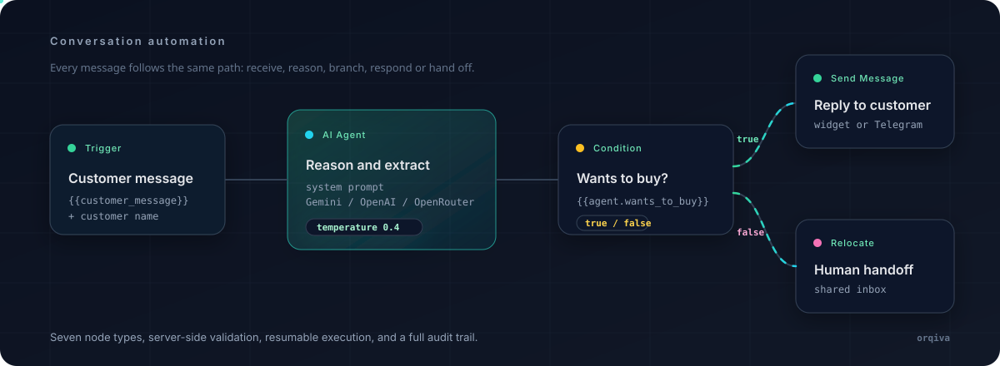
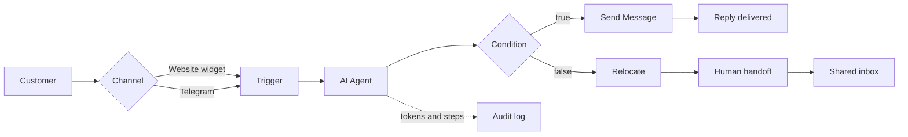

<p align="center">
  
</p>

<h1 align="center">Orqiva</h1>

<p align="center"><strong>Connect Intelligence. Automate Everything.</strong></p>

<p align="center">
  Open-source, local-first AI customer service automation.<br />
  Build a workflow, connect an AI agent, and answer customers on your website or Telegram.
</p>

<p align="center">
  <a href="https://www.npmjs.com/package/orqiva"></a>
  <a href="https://github.com/azaryageraldo/Orqiva/releases"></a>
  <a href="LICENSE"></a>
  
  
  
</p>

<p align="center">
  
</p>

Orqiva is a self-hostable alternative to hosted customer service bots. It runs entirely on your machine or server, keeps conversations in your own database, and uses your own AI provider key. No account, no cloud dependency, and no vendor lock-in.

## Why Orqiva

- **Local-first by default.** SQLite, the app, and the queue worker run on one machine. Your customer data never leaves your infrastructure.
- **Visual automation.** Design branching conversations on a canvas, validate them on the server, and reuse workflows across channels.
- **Bring your own key.** Gemini, OpenAI, and OpenRouter are supported with encrypted per-user API keys.
- **Real operations, not just a demo.** Inbox takeover, human handoff, resumable executions, token accounting, and per-step audit logs are built in.
- **One command to start.** The `orqiva` CLI bundles a FrankenPHP runtime, migrations, the queue worker, and the Telegram poller.

## How it works



Every execution is persisted. If a workflow waits for another customer message or a provider call fails, the run can resume from its last checkpoint instead of starting over.

## Node reference

| Node | Purpose |
| --- | --- |
| `Trigger` | Starts a run when a customer sends a message and exposes `{{customer_message}}` and `{{customer_name}}`. |
| `AI Agent` | Calls the selected provider with a system prompt, context window, and typed output variables. |
| `Send Message` | Sends a templated reply. Array output can be delivered as multiple bubbles. |
| `Condition` | Routes the flow through `true` / `false` branches based on an upstream boolean. |
| `Go To` | Jumps to another node or workflow owned by the same account. |
| `Relocate` | Hands the conversation to an admin and stops automated replies. |
| `Stopper` | Ends the flow cleanly with an outgoing edge. |

Server-side validation enforces one Trigger per runnable workflow, no incoming edges to the Trigger, terminal `Relocate` / `Go To` nodes, an outgoing edge for `Stopper`, both branches for `Condition`, at least one `Send Message` or `Relocate`, and a maximum of one starting-point `Go To`.

Variables use `{{namespace.variable}}` and array fields use `{{namespace.array.itemField}}`. The namespace comes from the AI Agent node name, which must be unique inside a workflow.

## Quick start

### npm (recommended)

Requires Node.js 20 or newer. PHP is not required.

```sh
npm install -g orqiva
orqiva
```

The CLI starts the bundled FrankenPHP runtime, creates the SQLite database, runs migrations, starts the queue worker and Telegram poller, and opens the browser. Use `orqiva stop` to shut everything down and `orqiva logs` to inspect the runtime, worker, and poller output.

Data lives in a shared Orqiva directory. Override it with `ORQIVA_DATA_DIR` when you want separate workspaces:

```sh
ORQIVA_DATA_DIR="$HOME/.local/share/orqiva-demo" orqiva
```

See [`packages/cli/README.md`](packages/cli/README.md) for environment variables, runtime details, and troubleshooting.

### From source

Requirements: PHP 8.3+, Composer, Node.js 20+, and npm. SQLite is the default database; MySQL 8 is optional.

```sh
# Backend
cd backend
composer install
cp .env.example .env
php artisan key:generate
php artisan migrate
php artisan serve

# Frontend, in another terminal
cd frontend
npm install
npm run dev
```

The API runs at `http://127.0.0.1:8000`. Vite serves the frontend at `http://127.0.0.1:5173` and proxies `/api` to the backend.

On first launch, complete the setup form to create the local admin account. There is no default email or password. For non-interactive setup, set `ORQIVA_ADMIN_EMAIL` and `ORQIVA_ADMIN_PASSWORD` and run:

```sh
php artisan db:seed --class=AdminUserSeeder
```

Add AI provider keys in **API Keys** inside the app. Keys are encrypted at rest and are never returned to the browser.

## Telegram

1. Create a bot with [@BotFather](https://t.me/BotFather) and copy its token.
2. Open **Channel → Telegram**, paste the token, choose an entry workflow, and activate the bot.
3. Send a message to the bot. Orqiva fetches updates through long polling, so no public URL, webhook, or tunnel is required.

When you use the CLI, the poller starts automatically with `orqiva`. From source, run `php artisan channels:telegram-poll` alongside `php artisan queue:work`.

## Testing and quality checks

```sh
cd backend && php artisan test
cd frontend && npm run lint && npm run build
cd packages/cli && npm test
```

Backend tests run against in-memory SQLite and mock AI providers. They do not require credentials or touch your local database.

## Security

- Keep server credentials in environment configuration. Never commit real secrets.
- Store AI keys through the app so they are encrypted with `APP_KEY`.
- Put public deployments behind HTTPS, restrict CORS, disable debug mode, and complete first-run setup with a strong account.
- Back up both the database and `APP_KEY`. Encrypted provider keys and channel credentials cannot be recovered without the same application key.

## Documentation

- [`README-SETUP.md`](README-SETUP.md) — installation, environment variables, operations, and troubleshooting.
- [`packages/cli/README.md`](packages/cli/README.md) — CLI runtime, data directory, and platform notes.
- **Help & Support** inside the app — quick start, all seven nodes with schema examples, variables, channel setup, inbox, audit logs, and security.

## Contributing

Issues, documentation fixes, and pull requests are welcome. Keep changes focused, follow PSR-12 and Laravel conventions on the backend, use strict TypeScript on the frontend, and add tests for workflow validation, execution behavior, authorization, and API changes.

## License

MIT License. Copyright (c) 2026 Azarya Geraldo. See [`LICENSE`](LICENSE).

<p align="center">
  Built by <a href="https://github.com/azaryageraldo">Azarya Geraldo</a> ·
  <a href="mailto:azaryageraldo79@gmail.com">azaryageraldo79@gmail.com</a>
</p>
